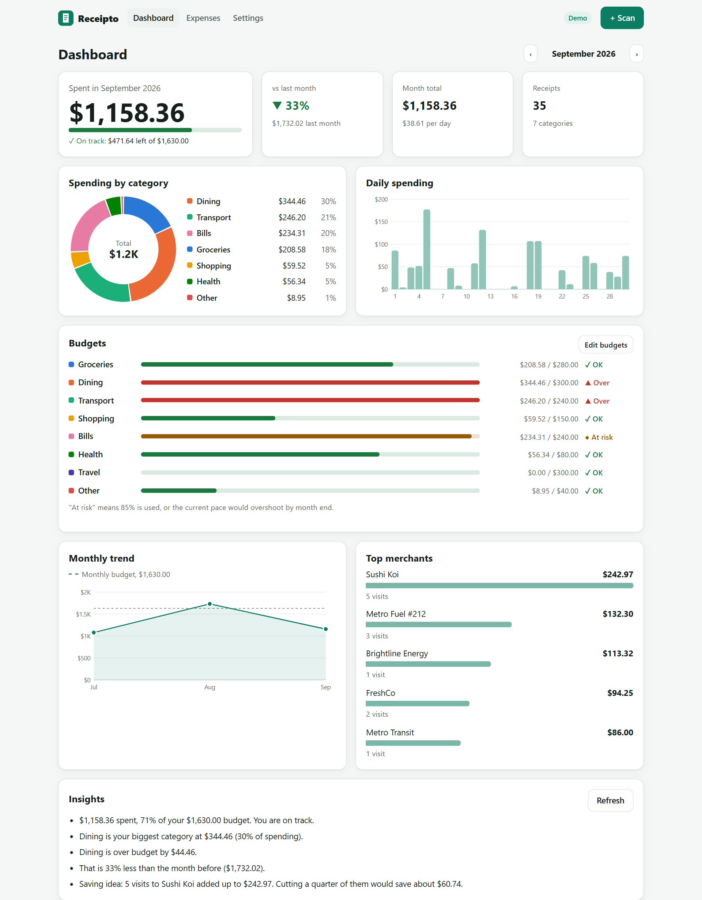
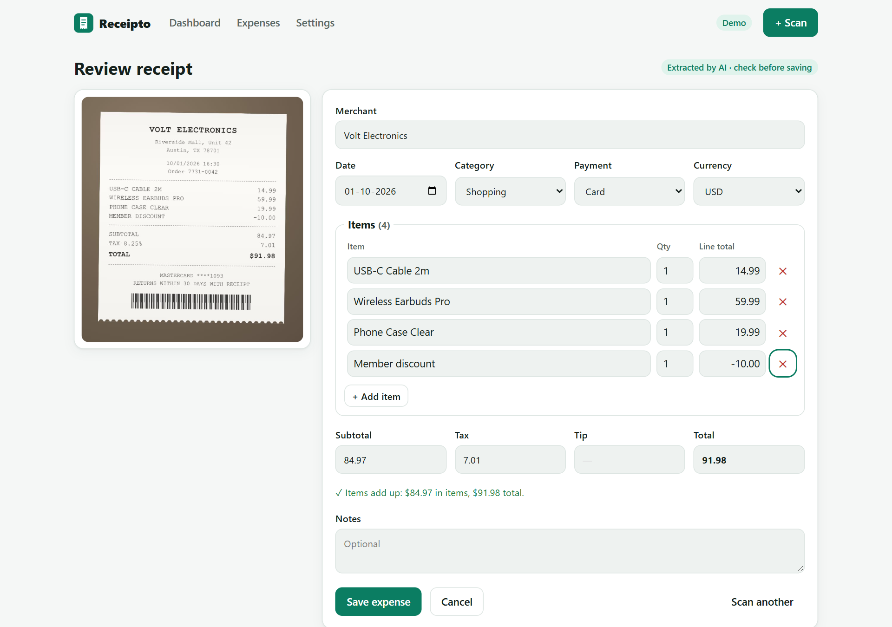
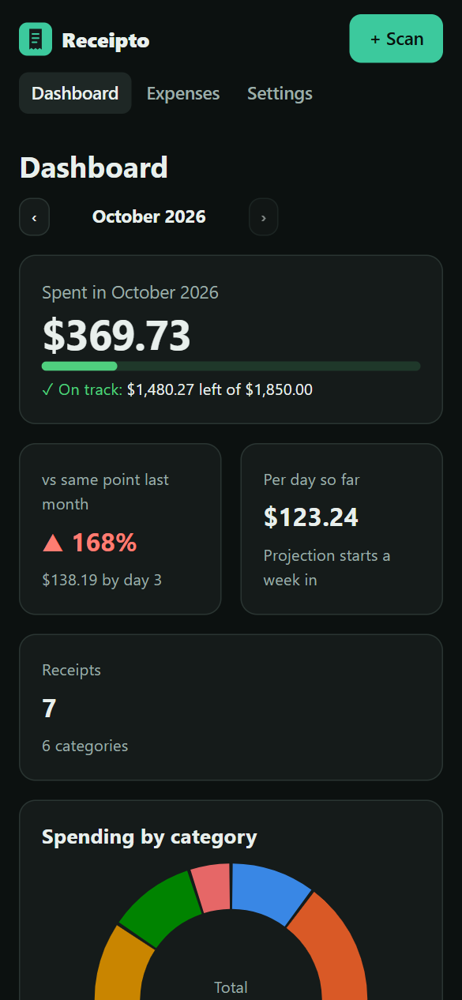
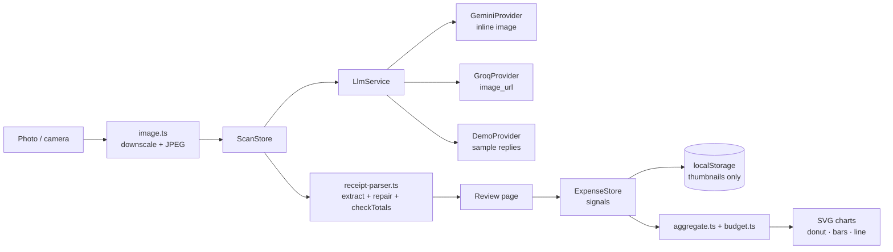

# Receipto


Snap or upload a receipt and Receipto reads it for you. A vision model pulls out the merchant, date, currency, line items, tax, tip, total, category and payment method. A validator then repairs messy output and checks that the numbers add up. You review everything next to the photo before it is saved. Your expenses then feed a dashboard with monthly budgets, a category donut, daily and monthly trends and top merchants. All the charts are hand-written SVG components.

**[▶ Live demo](https://konicamaheshwarii.github.io/receipt-scanner/)**: Demo mode is on by default, so you can try it without a key or sign-up. It includes six sample receipts and three months of history.



## Features

- **Scan or snap.** Upload an image, drop it on the page, or use the phone camera (`<input capture>`). Photos are downscaled to 1600 px and re-encoded as JPEG in the browser before upload, which usually brings them to a few hundred kB.
- **AI vision extraction.** The image goes inline (base64) to Google Gemini or a Groq Llama 4 vision model. The model is asked for strict JSON.
- **Validate and repair.** Amounts like `$1,234.56`, `1.234,56 €` and `(5.00)` are parsed. Dates like `09/27/2026`, `24.09.2026` and `Sep 25, 2026` become ISO dates, with a day/month-order setting for ambiguous ones. Currency symbols map to ISO codes, and free-text categories map to one of eight known categories. Missing totals and subtotals are rebuilt from the parts.
- **Totals check.** The validator checks items against the subtotal, then subtotal + tax + tip against the total. VAT-inclusive receipts are accepted. When the numbers disagree, a visible warning says by how much and offers a one-click fix.
- **Review before saving.** The receipt image sits next to editable fields. You can add or remove items and change the category, payment method and currency. Manual entry always works.
- **Expense list.** Search across merchants, items and notes. Filter by category and month, and sort by date, amount or merchant. You can edit any expense, and deletes can be undone.
- **Dashboard.** The month's total is compared with your budget, and early in the month the comparison with last month uses the same day of that month. You also get per-category budgets with ok / at-risk / over states, a spend-by-category donut, daily columns, a trend line over up to 6 months with the budget as a reference line, and top merchants.
- **Insights.** A short, streamed summary of the month. In Demo mode it comes from rules over your real numbers. Only totals are sent to the model, never images.
- **Export and backup.** You can export a CSV that is safe against spreadsheet formula injection. A JSON backup can be restored later; restoring validates every record and merges entries by id.
- **Private by design.** Data stays in this browser's localStorage, with only a 240 px thumbnail per receipt. The API key you bring is sent only to the provider you pick. There is no backend.
- **Light and dark themes, and phone layouts down to 390 px.** Charts can be used with the keyboard, and every mark has an accessible label.

| Review: the model missed a discount line | Mobile, dark |
|---|---|
|  |  |

## Architecture



Key design decisions:

- **The model output is untrusted.** Replies go through `extractJson`, which strips code fences, prose and `<think>` blocks, and then through `normalizeReceipt`. That function only produces typed, valid drafts, and it lists what the user should double-check. Text printed on a receipt is treated as data, not instructions. The spending data sent for insights is fenced in `<spending_data>` tags.
- **Demo mode uses the same pipeline.** The bundled sample replies are deliberately messy: strings with currency symbols, local date formats and labels like "Food & Drink". One sample also leaves out a discount line. So the demo exercises the real validator and the totals warning.
- **Pure functions for everything that can break.** Parsing, totals, aggregations, budgets and CSV live in small framework-free modules with unit tests. Stores and pages only compose them.
- **Hand-written SVG charts.** There is no chart library. Bar and line charts measure their host with a `ResizeObserver` and draw at real pixel size, so axis text never scales. Category colours come in one fixed order that was checked for colour-blind separation, and they get light and dark variants. Every mark is focusable and labelled, and the donut's legend doubles as a data table.
- **Signals and zoneless.** State lives in `ExpenseStore`, `ScanStore` and `SettingsStore` as signals and `computed`s. Components use `OnPush`, routes are lazy-loaded, and the initial transfer is about 75 kB.
- **Cancellation.** Scans and insight requests carry an `AbortSignal`. Leaving the page or starting another request cancels the old one.

```
src/app
├── core
│   ├── llm/              provider interface, Gemini, Groq, Demo, SSE reader
│   ├── demo/             sample receipts + seeded 3-month history
│   ├── parse.ts          amounts, currencies, dates, categories, payment methods
│   ├── receipt-parser.ts JSON extraction, normalisation/repair, totals check
│   ├── aggregate.ts      category / daily / monthly / merchant aggregations
│   ├── budget.ts         budget status, pace projection
│   ├── export.ts         CSV + JSON backup/restore
│   ├── image.ts          client-side downscale + compression
│   └── *.store.ts        expenses, scan pipeline, settings
├── features/             dashboard · scan · review · expenses · settings
└── shared/charts/        donut, bar and line SVG components
scripts/render-samples.mts  renders the sample receipt photos with puppeteer
```

## Getting started

```bash
npm install
npm start          # http://localhost:4200
npm run test:ci    # unit tests in headless Chrome
npm run build
```

To scan your own receipts, open **Settings** and switch from Demo to Gemini or Groq, then paste a free key:
[Gemini](https://aistudio.google.com/apikey) · [Groq](https://console.groq.com/keys).

The sample receipt images in `public/samples` are generated from `src/app/core/demo/samples.ts`. To regenerate them, run `npx -p puppeteer node scripts/render-samples.mts` (needs Node 22.18 or newer).

## Testing

51 unit tests cover the logic most likely to break:

- amount, currency and date parsing (US and European formats, discounts, ambiguous dates)
- the extraction parser, repair rules and the totals check, including every bundled sample
- category, daily, monthly and merchant aggregations
- budget states and month progress
- CSV escaping and formula injection, and backup round-trips with invalid records
- the expense store (seeding, add, edit, undo, merge restore)
- the scan pipeline, run against real canvas-encoded images
- SSE parsing, the demo provider and chart geometry

CI (GitHub Actions) runs the tests and the production build on every push, then deploys `main` to GitHub Pages.

## License

[MIT](LICENSE)
